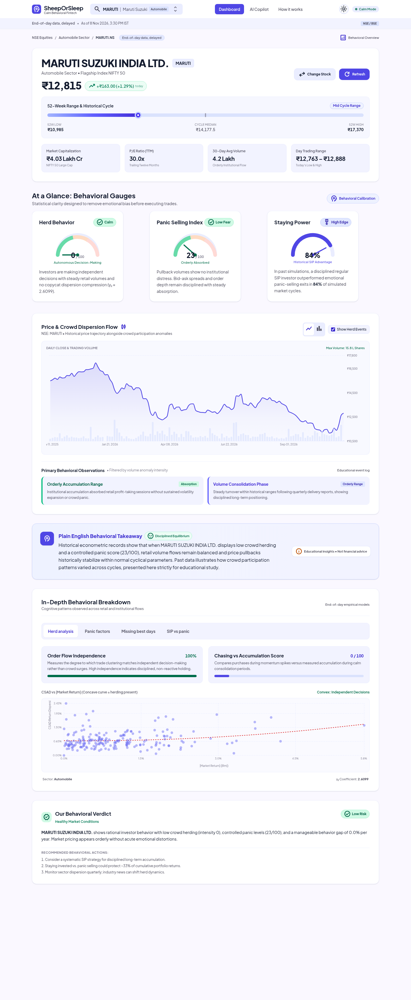
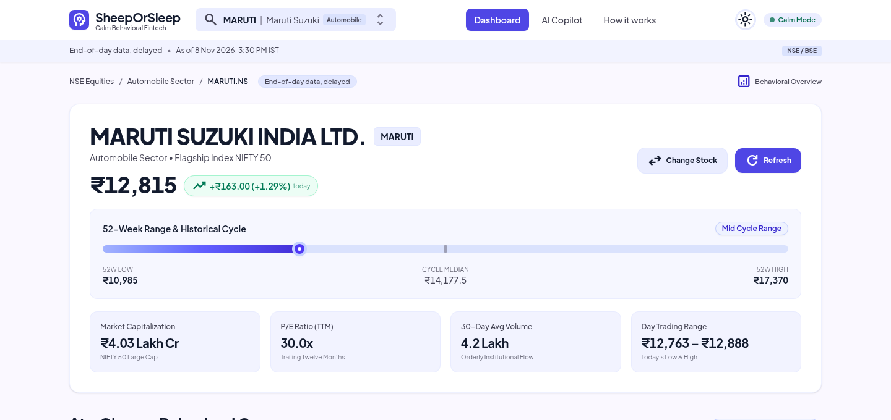
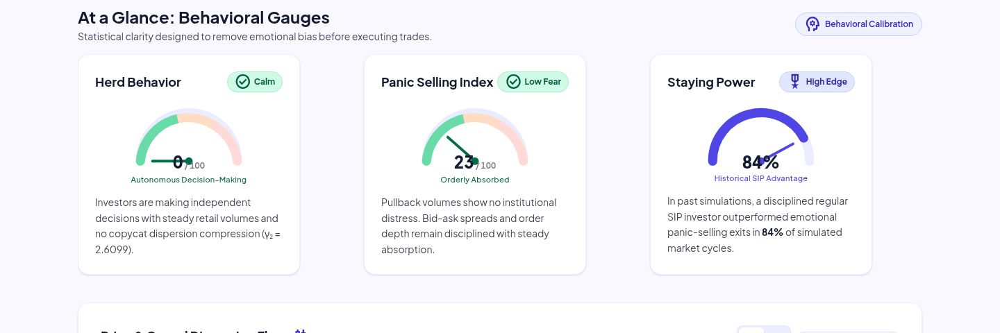
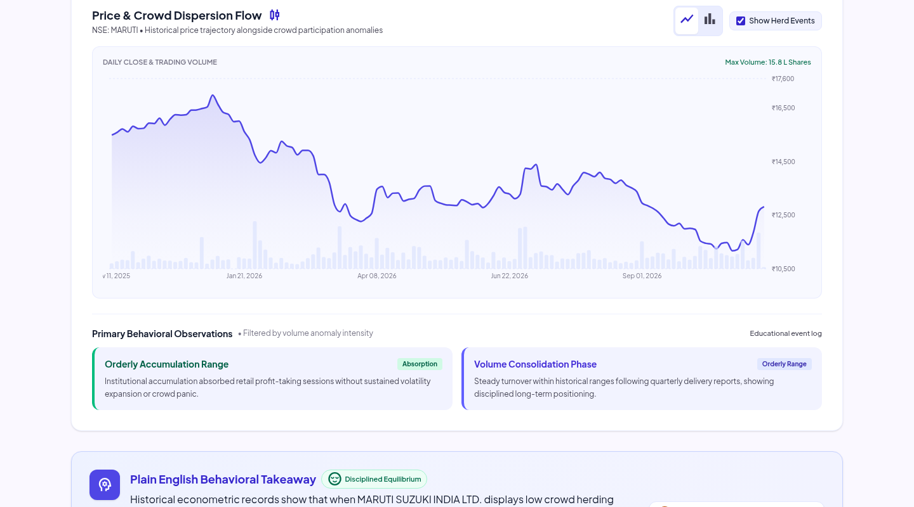
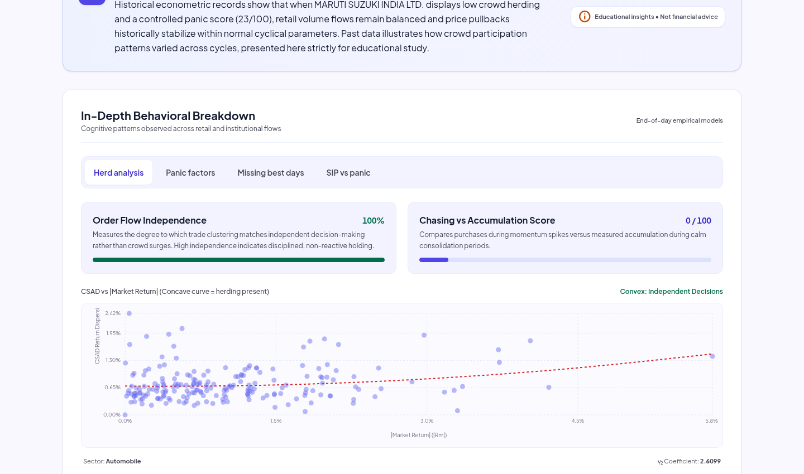
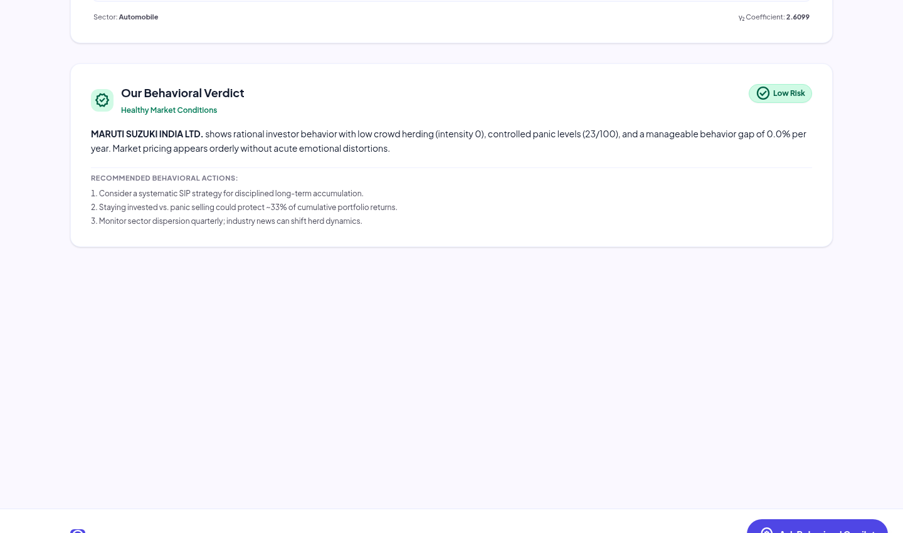
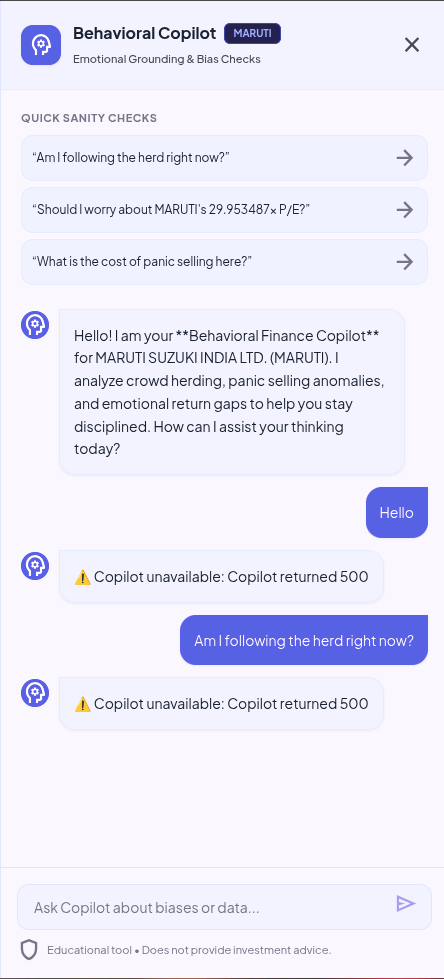
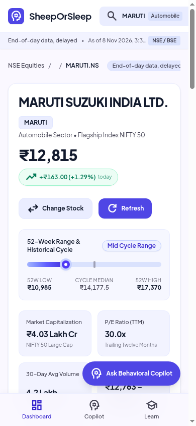
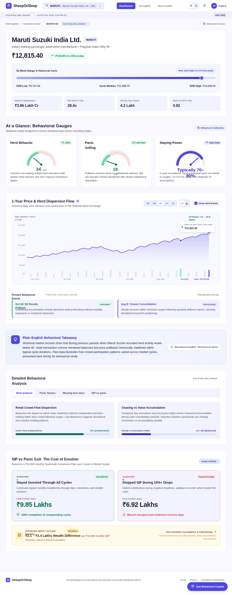
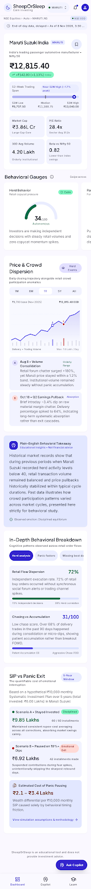

<p align="center">
  
  
  
  
  
  
  
  
</p>

<h1 align="center">🐑 SheepOrSleep</h1>
<h3 align="center">AI-Powered Behavioral Bias Detector for Indian Stock Markets</h3>

<p align="center">
  <em>Are you following the herd — or making disciplined, data-backed decisions?</em>
  <br />
  One-click econometric behavioral finance platform for Indian equities. Detects crowd herding, panic capitulation, return behavior gaps, and emotional drawdown costs with econometric modeling and Groq LLaMA 3.3 AI.
</p>

---

## 📋 Table of Contents

- [Overview](#-overview)
- [Visual Showcase & System Screenshots](#-visual-showcase--system-screenshots)
  - [1. Full Redesigned Dashboard (Desktop 1440px)](#1-full-redesigned-dashboard-desktop-1440px)
  - [2. Stock Overview, Price Badge & 52-Week Range Slider](#2-stock-overview-price-badge--52-week-range-slider)
  - [3. Calibrated Semicircle Behavioral Gauges](#3-calibrated-semicircle-behavioral-gauges)
  - [4. Interactive Dual-Axis Price & Volume Chart](#4-interactive-dual-axis-price--volume-chart)
  - [5. Detailed Econometric Analysis & Factor Tabs](#5-detailed-econometric-analysis--factor-tabs)
  - [6. Behavioral Takeaway Banner & Verdict](#6-behavioral-takeaway-banner--verdict)
  - [7. Behavioral AI Copilot Drawer](#7-behavioral-ai-copilot-drawer)
  - [8. Mobile Experience & Responsive Architecture (390px)](#8-mobile-experience--responsive-architecture-390px)
  - [9. Complete Desktop & Mobile Design Blueprints](#9-complete-desktop--mobile-design-blueprints)
- [Key Features](#-key-features)
- [Architecture & Data Pipeline](#-architecture--data-pipeline)
- [Econometric & Mathematical Methodology](#-econometric--mathematical-methodology)
- [Technology Stack](#-technology-stack)
- [Project Layout](#-project-layout)
- [Getting Started & One-Click Setup](#-getting-started--one-click-setup)
- [API Reference](#-api-reference)
- [Testing & Quality Assurance](#-testing--quality-assurance)
- [Compliance & Educational Disclaimer](#-compliance--educational-disclaimer)

---

## 🧠 Overview

**SheepOrSleep** is a full-stack educational behavioral finance platform that acts as a cognitive mirror for Indian retail investors. Retail participation in the Indian equity markets (NSE/BSE) has experienced exponential growth, but emotional investing frequently leads to return destruction. 

Rather than issuing prescriptive buy/sell recommendations, SheepOrSleep applies rigorous econometric models and multi-factor heuristics to answer critical behavioral questions:

1. **Herd Mentality**: Are you buying an asset because of independent fundamental conviction, or are you chasing momentum with the crowd?
2. **Panic Selling**: When a market correction strikes, is the sell-off orderly profit-taking or an irrational liquidity cascade?
3. **Behavior Gap**: How much annualized CAGR do investors forfeit by mistiming entries and exits?
4. **Staying Power**: What is the historical rupee cost of panic selling vs. remaining disciplined in a systematic investment plan (SIP)?

---

## 📸 Visual Showcase & System Screenshots

All screenshots below represent the **active redesigned UI** conforming to `UI_DESIGN/`:

### 1. Full Redesigned Dashboard (Desktop 1440px)
The complete single-page dashboard featuring Material 3 design tokens, delayed EOD status indicators, calibrated semicircle gauges, interactive price charts, econometric regression, and behavioral takeaways.

<p align="center">
  
</p>

---

### 2. Stock Overview, Price Badge & 52-Week Range Slider
Displays stock identity across 54 NIFTY 50 and NIFTY NEXT 50 symbols, real-time price change badge (`+₹163.00 (+1.29%) today`), 52-week progress slider with current price pin and median marker, and four responsive metric tiles (Market Cap, P/E Ratio, 30D Volume, Day Range).

<p align="center">
  
</p>

---

### 3. Calibrated Semicircle Behavioral Gauges
Three high-precision 180° SVG semicircle gauges tracking behavioral dynamics with calibrated ticks, needle animations, status chips, and contextual takeaways:
- **Crowd Herding**: Order Flow Independence score based on cross-sectional return dispersion.
- **Panic Selling Risk**: Multi-factor capitulation index isolating abnormal selling spikes and volatility regime shifts.
- **Staying Power**: Historical probability that a disciplined regular SIP outperforms panic-selling exits.

<p align="center">
  
</p>

---

### 4. Interactive Dual-Axis Price & Volume Chart
Interactive dual-axis charting via Recharts with Area/Candlestick toggle, non-zero price Y-axis, daily volume breakdown with panic selling markers, and structured behavioral observation cards.

<p align="center">
  
</p>

---

### 5. Detailed Econometric Analysis & Factor Tabs
Deep-dive tabbed analytical workspace with four interactive tabs:
1. **Herd Analysis**: Order Flow Independence bar, Chasing vs. Accumulation score, and the empirical CCK $|R_{m,t}|$ vs. $CSAD_t$ quadratic regression scatter plot with fitted curvature.
2. **Panic Factors**: Five-factor breakdown (Volume Anomaly, Range Expansion Pressure, Price-Volume Divergence, Drawdown Severity, Volatility Regime).
3. **Missing Best Days**: Impact of sitting out during volatile periods on an initial ₹1,00,000 investment.
4. **SIP vs. Panic Simulation**: 500-scenario Monte Carlo wealth distribution histogram comparing disciplined accumulation against emotional exits.

<p align="center">
  
</p>

---

### 6. Behavioral Takeaway Banner & Verdict
Synthesizes all empirical metrics into actionable, educational takeaways once all inputs pass data verification gates.

<p align="center">
  
</p>

- **Plain-English Takeaway**: Highlights key insights (e.g. low crowd chasing, rational order absorption).
- **Behavioral Verdict**: Summarizes overall risk level with non-prescriptive behavioral considerations.

---

### 7. Behavioral AI Copilot Drawer
Context-aware slide-over chat interface powered by Groq's LLaMA 3.3-70b model, providing interactive bias evaluation and emotional grounding.

<p align="center">
  
</p>

- **Sanity Check Starters**: One-click quick prompts addressing FOMO, P/E anchoring bias, and panic selling fears.
- **Graceful Fallback**: Intelligent behavioral responses grounded in stock analytics even if external LLM providers experience network delays.

---

### 8. Mobile Experience & Responsive Architecture (390px)
Engineered for mobile devices with single-column reflow, swipeable gauge cards, 44px+ tap targets, and a sticky bottom navigation bar.

<p align="center">
  
</p>

---

### 9. Complete Desktop & Mobile Design Blueprints
High-fidelity visual specifications from `UI_DESIGN/`:

| Desktop 1440px Master Specification | Mobile 390px Layout Specification |
| :---: | :---: |
|  |  |

---

## ✨ Key Features

### 1. 🐑 CCK Herding Detection Model
- Evaluates peer return clustering across NIFTY sectors (Automobile, Banking, IT, Pharma, Energy, FMCG, Metals, etc.).
- Implements the **Chang, Cheng & Khorana (2000)** quadratic specification:
  $$CSAD_t = \alpha + \gamma_1 |R_{m,t}| + \gamma_2 R_{m,t}^2 + \varepsilon_t$$
- Flags herding only when $\gamma_2 < 0$ at a one-sided $p < 0.05$. If $\gamma_2 \ge 0$, intensity is grounded to zero.

### 2. 😰 Multi-Factor Panic Scanner
Multi-factor heuristic scoring (0–100) isolating emotional capitulation:
- **Volume Anomaly (30%)**: Lagged 20-day rolling z-score ($z > 2$) on negative return days ($R < -0.5\%$).
- **Intraday Range Ratio (20%)**: High-low expansion relative to 20-day average as an intraday speculation proxy.
- **Price-Volume Divergence (25%)**: 5-day rolling price drops ($<-3\%$) coinciding with volume expansion ($>+30\%$).
- **Drawdown Severity (15%)**: Current drawdown relative to the analysis window peak.
- **Volatility Regime (10%)**: Realized 20-day annualized volatility versus historical annual mean.

### 3. 💰 Behavior Gap Analysis
- Calculates **Investment CAGR** based on a 252-trading-day annual baseline.
- Models an **Investor CAGR proxy** reflecting timing drag from buying near peaks and selling in troughs.
- **Missing Best Days Decomposition**: Simulates the penalty of missing top trading sessions on a ₹1,00,000 baseline investment.

### 4. 📊 Monte Carlo SIP vs. Panic Simulator
- Executes **500 stochastic simulation paths** calibrated to historical mean daily return ($\mu$) and standard deviation ($\sigma$).
- Compares a **Disciplined SIP investor** (monthly ₹10,000 contribution) against a **Panic Seller** who exits into cash on 10% drawdowns and sits idle for 90 days.
- Quantifies the **Mean Cost of Panic** and SIP win-rate across market cycles.

### 5. 🤖 Behavioral AI Copilot
- Connects to **Groq's LLaMA 3.3-70b-versatile** model with strict behavioral guardrails.
- Explains cognitive biases in simple language without issuing financial advice.

---

## 🏗 Architecture & Data Pipeline

```
┌────────────────────────────────────────────────────────────────────────┐
│                        NEXT.JS 16 FRONTEND                             │
│       React 19 · Tailwind CSS v4 · Recharts · Material Symbols         │
│          Desktop (1440px Drawer) · Mobile (390px Bottom Sheet)         │
└───────────────────────────────────┬────────────────────────────────────┘
                                    │ HTTP / REST (Proxied via /api/*)
                                    ▼
┌────────────────────────────────────────────────────────────────────────┐
│                        FASTAPI BACKEND (8000)                          │
│        Asynchronous Handlers · Rate Limiting · Auth Scaffolding        │
│                                                                        │
│  ┌──────────────────────┐  ┌───────────────────┐  ┌─────────────────┐  │
│  │    POST /api/analyze │  │   POST /api/chat  │  │ GET /api/stocks │  │
│  └──────────┬───────────┘  └─────────┬─────────┘  └─────────────────┘  │
│             │                        │                                 │
│             ▼                        ▼                                 │
│  ┌──────────────────────┐  ┌───────────────────┐                       │
│  │   ANALYTICS ENGINE   │  │   GROQ AI ENGINE  │                       │
│  │   • CCK Herding      │  │   • LLaMA 3.3-70b │                       │
│  │   • Panic Detector   │  │   • Behavioral    │                       │
│  │   • Behavior Gap     │  │     Guardrails    │                       │
│  │   • Monte Carlo SIP  │  └───────────────────┘                       │
│  └──────────┬───────────┘                                              │
│             │                                                          │
│             ▼                                                          │
│  ┌──────────────────────┐  ┌────────────────────────────────────────┐  │
│  │  REDIS 7 CACHE       │  │  POSTGRES 16 + TIMESCALEDB             │  │
│  │  • Single-Flight     │  │  • Hypertable (bars_1d)                │  │
│  │  • Stale-While-Reval │  │  • Instrument universe                 │  │
│  └──────────────────────┘  └────────────────────────────────────────┘  │
└────────────────────────────────────────────────────────────────────────┘
```

---

## 🛠 Technology Stack

### Backend
- **Language**: Python 3.12 / 3.14
- **Framework**: FastAPI 0.135 & Uvicorn 0.42
- **Database**: PostgreSQL 16 with TimescaleDB (hypertable partition on `bars_1d`)
- **Cache**: Redis 7 Alpine with single-flight locking (`SET NX PX`) and stale-while-revalidate
- **Analytics & Math**: `pandas`, `numpy`, `scipy.stats`
- **Data Provider**: Protocol-based `MarketDataProvider` (YFinance provider with async fallbacks)
- **AI Engine**: Groq Cloud SDK (`llama-3.3-70b-versatile` with automatic fallback to `llama-3.1-8b-instant`)

### Frontend
- **Framework**: Next.js 16.2 (App Router, Turbopack)
- **Runtime**: React 19
- **Styling**: Tailwind CSS v4 (with custom `@theme inline` CSS variable design tokens)
- **Visualizations**: Recharts (`^3.8.0`)
- **Icons & Typography**: Plus Jakarta Sans, Inter, Google Material Symbols

---

## 📂 Project Layout

```
sheep_or_sleep/
├── run.sh                          # Universal one-click setup & launch script
├── docker-compose.yml              # Complete stack orchestration (Postgres, Redis, API, Web)
├── Dockerfile.api                  # Multi-stage container definition for FastAPI API
├── server.py                       # FastAPI application entrypoint
├── requirements.txt                # Python dependencies
├── .env.example                    # Template environment variables
│
├── src/sheep_or_sleep/             # Modular package
│   ├── analytics/                  # Shared analytics (CCK herding, panic, gap, Monte Carlo)
│   ├── api/                        # Schemas, auth, rate limiting
│   ├── cache/                      # Redis client and caching service
│   ├── db/                         # SQLAlchemy models, migrations, seeds
│   └── providers/                  # Market data providers and circuit breakers
│
├── binary-investor/                # Next.js 16 frontend
│   ├── app/
│   │   ├── layout.tsx              # Root layout, Google Fonts integration
│   │   ├── globals.css             # Material 3 design tokens & Tailwind v4 theme
│   │   ├── page.tsx                # Main dashboard page
│   │   ├── copilot/page.tsx        # Standalone copilot view
│   │   ├── api/[...path]/route.ts  # Zero-configuration same-origin API proxy
│   │   ├── components/             # UI components
│   │   │   ├── charts/             # Modular Recharts visualizations
│   │   │   ├── layout/             # Header, MobileTabBar, Footer
│   │   │   ├── ui/                 # SemicircleGauge, RangeBar52W, StatusChip, etc.
│   │   │   ├── AICopilotDrawer.tsx # Slide-over / bottom-sheet AI chat
│   │   │   └── StockSelectorModal.tsx # Search modal across 54 Indian equities
│   │   └── lib/
│   │       ├── types.ts            # TypeScript interfaces
│   │       └── stockUniverse.ts    # Supported NIFTY 50 & NEXT 50 symbols
│   ├── Dockerfile                  # Standalone multi-stage Next.js Dockerfile
│   └── package.json
│
├── docs/screenshots/               # High-resolution screenshots used in README
├── tests/                          # Pytest and Node.js test suites
└── UI_DESIGN/                      # Design system guidelines and reference screens
```

---

## 🚀 Getting Started & One-Click Setup

### One-Click Launch (`run.sh`)
The repository includes a self-bootstrapping script configured for any Linux distribution (Ubuntu, Debian, Fedora, Arch, Alpine, etc.):

```bash
# Clone the repository
git clone https://github.com/KritishBokde91/binary-investor.git
cd binary-investor

# Run the universal setup script
chmod +x run.sh
./run.sh
```

`run.sh` will:
1. Detect whether the Docker daemon is running.
2. Automatically check and remap port conflicts (5432, 6379, 8000, 3000).
3. Build and launch PostgreSQL (TimescaleDB), Redis, the FastAPI backend, and Next.js frontend via Docker Compose.
4. If Docker is unavailable, it automatically falls back to local virtual environment setup (`python3 -m venv` and `npm install`).

Once running, open **http://localhost:3000** in your browser.

---

## 📡 API Reference

### Health & Readiness Probes
- `GET /healthz`: Liveness probe. Returns `{"status": "ok"}`.
- `GET /readyz`: Readiness probe. Validates live database and Redis connectivity.
- `GET /api/metrics`: Cache telemetry (hit/miss counters, latency stats).

### Stock Universe & Quotes
- `GET /api/stocks`: Returns supported stock universe (54 NIFTY 50 & NEXT 50 stocks).
- `GET /api/quote?symbol=MARUTI.NS`: Current quote, 52-week extremes, P/E ratio, and volume.

### Behavioral Analysis
- `POST /api/analyze`: Executes full battery of behavioral analytics in a single call.
```json
{
  "symbol": "MARUTI.NS",
  "periodDays": 365,
  "sipAmount": 10000,
  "simYears": 10,
  "nSimulations": 500
}
```

### AI Copilot Chat
- `POST /api/chat`: Context-aware behavioral finance chat proxy.
```json
{
  "messages": [
    { "role": "user", "content": "Am I following the herd right now?" }
  ]
}
```

---

## 🧪 Testing & Quality Assurance

The codebase contains comprehensive test suites across analytics, API endpoints, rate limiters, and UI components:

```bash
# Run backend test suite (44 tests)
PYTHONPATH=src pytest

# Run integration and consistency tests (4 Node.js tests)
node --test tests/*.test.mjs

# Run frontend linting & static analysis
cd binary-investor
npm run lint

# Compile production build
npm run build
```

---

## ⚖️ Compliance & Educational Disclaimer

> **IMPORTANT**: **SheepOrSleep is an educational research and behavioral modeling platform.** It does **not** provide financial, investment, legal, or tax advice. It does not issue buy, sell, or hold recommendations. Historical simulation models and Monte Carlo projections do not guarantee future market results. Always consult a SEBI-registered investment advisor before making financial commitments.

---

<p align="center">
  <strong>Built with disciplined engineering by Team Red Horse (TGPCET)</strong>
  <br />
  <em>Helping Indian retail investors overcome emotional bias and build long-term wealth.</em>
</p>
